<p align="center">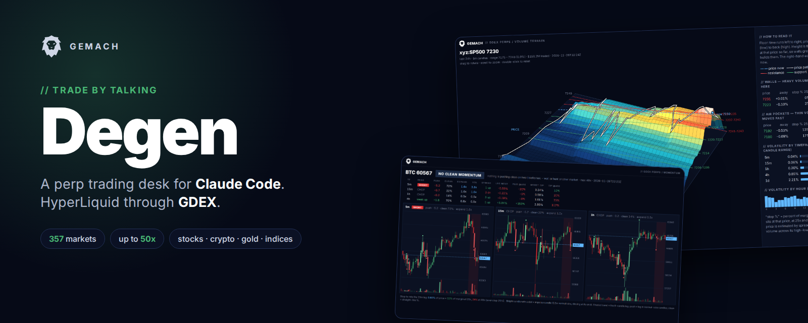</p>

# Degen

**A perp trading desk you run by talking to Claude Code.** It trades [HyperLiquid](https://hyperliquid.xyz) perps through
[GDEX](https://gdex.pro): crypto, US stocks, indices, gold, oil and private-company markets, at up to 50x.

You say *"show me the action"*, *"scope the S&P"*, *"long it, stop under 7200, target 7300"*, *"stop to breakeven"*. Claude runs the
tools, shows you the charts, tells you what the trade will cost, and places it with the stop and target attached.

It is plain Node scripts. Every tool also works by hand in a terminal, with no AI involved.

> [!WARNING]
> **This trades real money at high leverage, and the default size is 80% of your account per trade.** Most leveraged traders lose
> money. Nothing here is a signal that has been shown to make money: the replays in [`research/FINDINGS.md`](research/FINDINGS.md)
> found no rule with a proven edge after fees. The tools help you see and act faster. They do not predict. Start small, and change
> the default size if 80% is not your style ([Sizing](docs/TRADING.md#sizing)). Not financial advice. Check that leveraged
> derivatives are legal where you live.

---

## Contents

- [What you get](#what-you-get)
- [Install in five minutes](#install-in-five-minutes)
- [Fund it](#fund-it)
- [Use it with Claude Code](#use-it-with-claude-code)
- [The tools, with pictures](#the-tools-with-pictures)
- [Placing and managing trades](#placing-and-managing-trades)
- [Fees](#fees)
- [Safety](#safety)
- [More docs](#more-docs)

## What you get

| | Tool | What it answers |
|---|---|---|
| 🔭 | **Sectors** | Where is money rotating across all 350+ markets? |
| 🔥 | **Scanner** | What is moving hardest right now, against its own normal? |
| 🚀 | **Momentum** | How hard and how clean is the move, on 5m / 15m / 1h / 4h? |
| 🎯 | **Levels** | Where are the zones, and what does a stop behind each one cost me? |
| 🏔️ | **3-D terrain** | Where did the volume trade? Walls and air pockets. |
| 📡 | **Tracker** | Chop, trend or turning? A radar-style filter on price. |
| 🧰 | **Scope** | All of the above on one market, with chart images. |
| 💼 | **Positions** | What am I in and what am I up? |
| 🧾 | **Scorecard** | My real closed trades against the break-even line. |
| ⚡ | **Order engine** | Fire, limit, move the stop, extend the target, close. One line each. |
| 🛠️ | **Setup** | Create a wallet, see where to send money, deposit, withdraw. |

## Install in five minutes

You need [Node.js](https://nodejs.org) 20 or newer and git. macOS, Linux, or Windows with WSL.

```bash
git clone https://github.com/GemachDAO/degen-harness.git
cd degen-harness
npm install          # the GDEX SDK (about a minute)
node setup.js        # creates your wallet and shows your deposit address
```

<p align="center">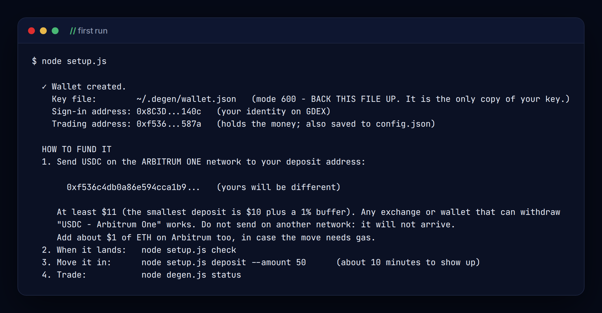</p>

`setup.js` makes a new wallet just for this harness and saves the key to `~/.degen/wallet.json` on your machine (readable only by
you). **Back that file up.** It is the only copy. Nobody can recover it for you.

Optional, for chart images (a 150 MB browser download):

```bash
npm run charts
```

The full walk-through, including Windows notes and how to use a wallet you already have, is in [docs/INSTALL.md](docs/INSTALL.md).

## Fund it

Trading money is **USDC**. You send it once to your deposit address, then move it into the exchange.

| Step | What you do | How long |
|---|---|---|
| 1 | Send **USDC on the Arbitrum One network** to the deposit address `setup.js` printed. At least $11. Send about $1 of **ETH on Arbitrum** to the same address too: the deposit pays its gas from it (a fraction of a cent). | 1 to 5 minutes |
| 2 | `node setup.js check` to see that it landed | instant |
| 3 | `node setup.js deposit --amount 50` moves it into your HyperLiquid account | about 10 minutes |
| 4 | `node setup.js check` again. When "HyperLiquid account" shows your money, you can trade crypto markets. | |
| 5 | `node setup.js enable`, once. It opens stock, index and commodity markets (`xyz:NVDA`, `xyz:SP500`...) to a new account. Free. | seconds |

<p align="center">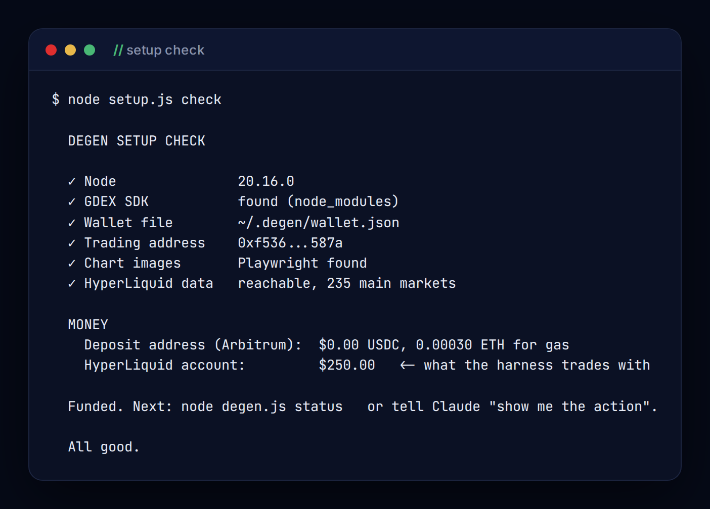</p>

Where to get USDC on Arbitrum: Coinbase, Binance, Kraken, OKX and most large exchanges let you withdraw USDC and choose
"Arbitrum One" as the network. From a wallet such as MetaMask or Rabby, send USDC while on the Arbitrum network.

> [!CAUTION]
> Send **USDC**, on **Arbitrum One**, to **your** deposit address. Money sent on another network (Ethereum, Base, Solana...) or
> another token will not arrive. If you are unsure, send $11 first.

Taking money out:

```bash
node setup.js withdraw --amount 50                 # HyperLiquid -> your deposit address on Arbitrum ($1 exchange fee)
node setup.js send --to 0xYourOwnAddress --amount 49   # deposit address -> any Arbitrum address you control
```

Add `--dry` to any money command to see what it would do without sending anything.

## Use it with Claude Code

Install [Claude Code](https://claude.com/claude-code), then either:

**A. Start Claude inside the folder.** The skill loads by itself.

```bash
cd degen-harness
claude
```

**B. Install the skill for every folder.**

```bash
node setup.js claude
```

Then talk:

| You say | Claude does |
|---|---|
| "show me the action" | Sectors, scanner, momentum hunt and your positions |
| "scope the S&P" / "let me see NVDA" | Momentum, levels, tracker, plus three chart images |
| "levels on gold" | Zones, and what a stop behind each one costs at half and max leverage |
| "long BTC, stop under 60k, target 62.4k, half leverage" | Plans it, tells you margin, dollars at risk, fee and warnings, then places it |
| "limit long at 59,300" | A resting entry with the stop and target riding on it |
| "stop to breakeven" / "lock in 30%" | Moves the stop |
| "extend the target to 150%" / "let it run" | Moves or removes the target |
| "close it" | Closes at market |
| "what am I up" | Positions and P&L |
| "how am I doing" | Your scorecard |
| "am I set up" / "deposit 50" | Setup check, or moves your deposit in |

`node setup.js claude` also prints an optional status line (equity and open P&L under the prompt) and permission rules so Claude can
run the read-only tools without asking each time. More in [docs/CLAUDE-CODE.md](docs/CLAUDE-CODE.md).

## The tools, with pictures

Every tool takes `--no-color`, and most take `--json`. Stock and other builder-venue markets are written `venue:TICKER`, for example
`xyz:NVDA`, `xyz:SP500`, `xyz:SILVER`. Full reference: [docs/TOOLS.md](docs/TOOLS.md).

### Sectors: the whole board

```bash
node sectors.js
node sectors.js --sector semis
```

<p align="center">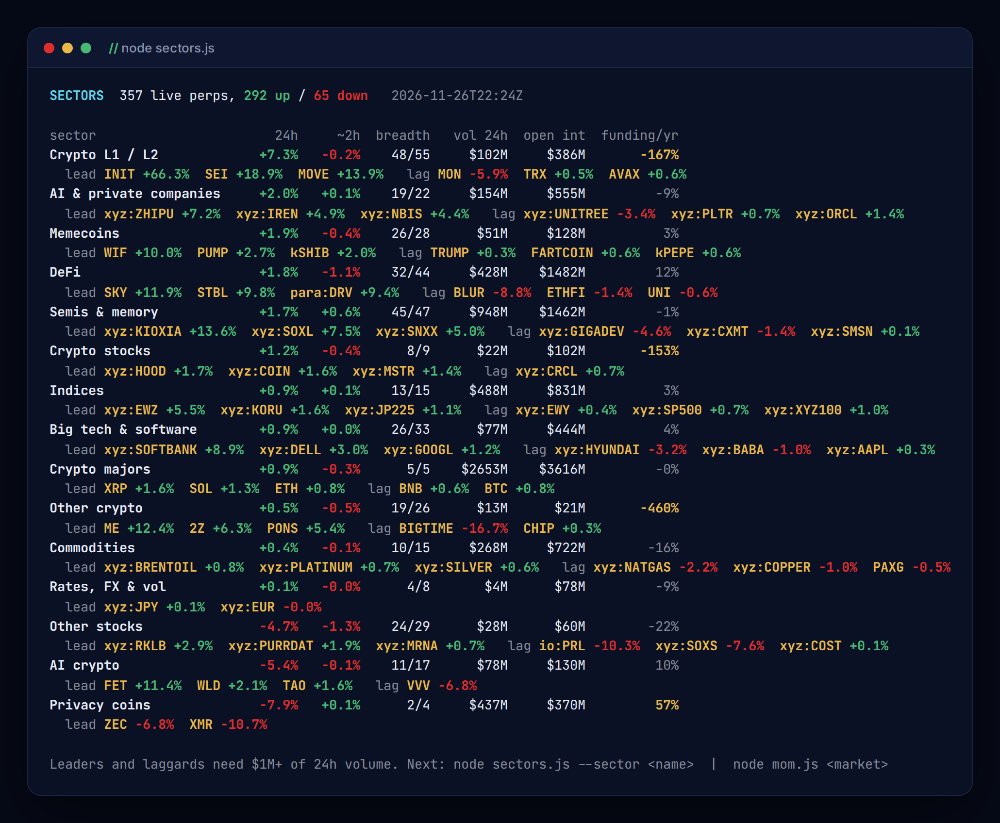</p>

### Scanner: what is moving hardest

```bash
node scan.js --top 12
```

"Heat" is the last hour's range against that market's normal hourly range. 2.0 means twice as wild as usual.

<p align="center">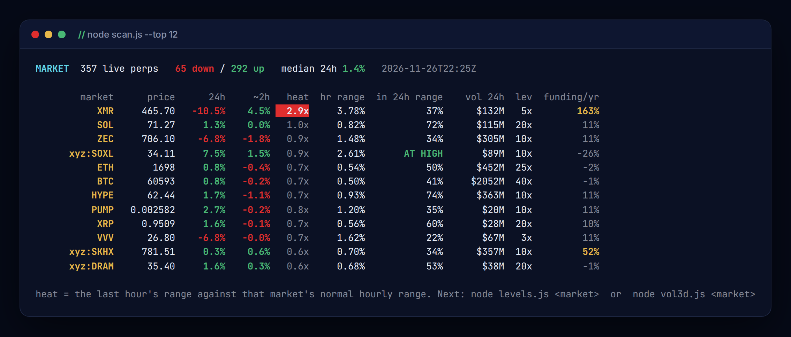</p>

### Momentum: how hard and how clean

```bash
node mom.js --hunt --top 10     # rank the most traded markets
node mom.js BTC --png           # one market, with a chart
```

<p align="center">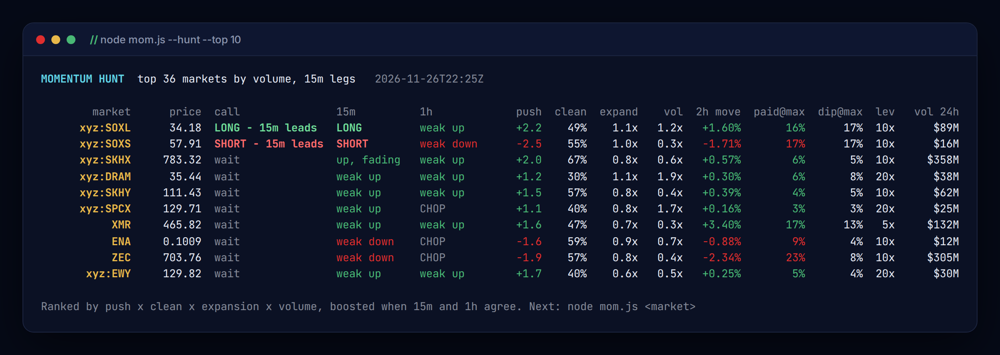</p>
<p align="center">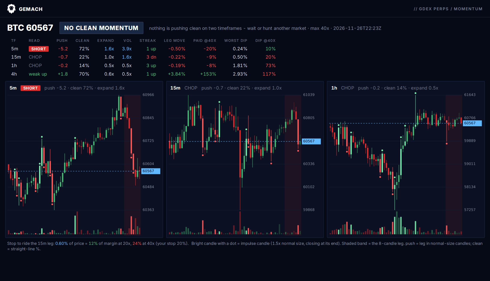</p>

### Levels: zones, and what a stop there costs

```bash
node levels.js xyz:SP500
```

Each zone shows the stop just past it and how much of your margin that stop loses at half and at max leverage. `LIQ` means the
position would be liquidated before the stop could trigger.

<p align="center">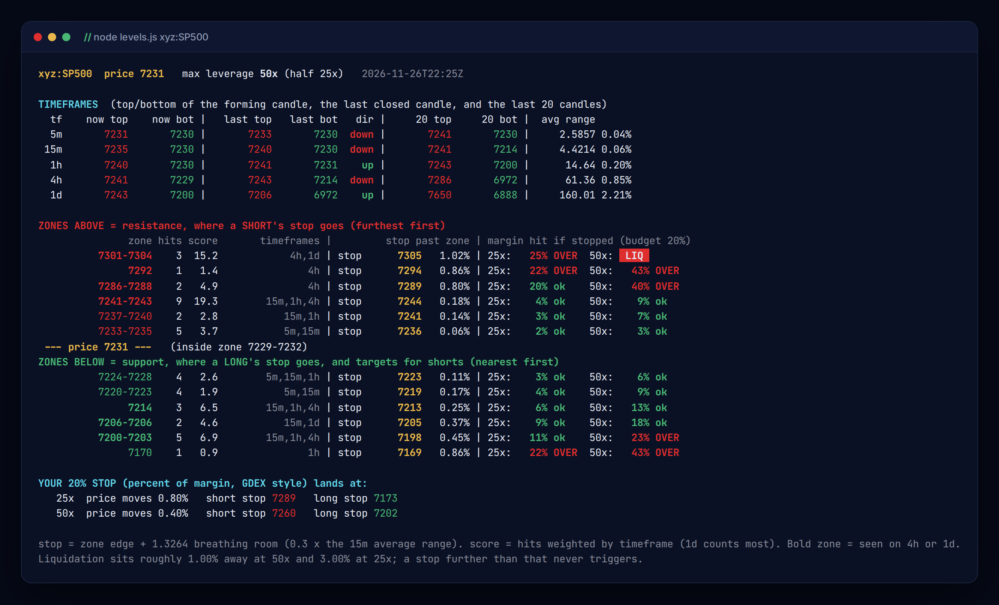</p>

### 3-D terrain: where the volume traded

```bash
node vol3d.js xyz:SP500 && node shot.js out/xyz-SP500-3d.html
```

Mountains are prices the market fought over. Valleys are thin air where price travels fast. The white line is price walking over
the terrain. The `.html` file is interactive: drag to rotate.

<p align="center">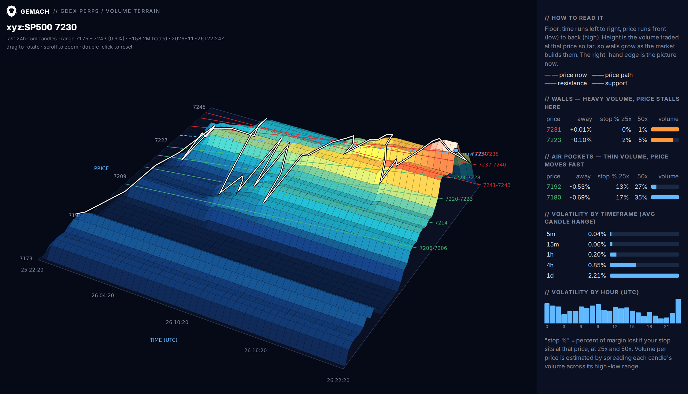</p>

### Tracker: chop, trend or turning

```bash
node track.js BTC --png
```

It runs three motion models at once, the way radar follows an aircraft, and reports which one fits.

<p align="center">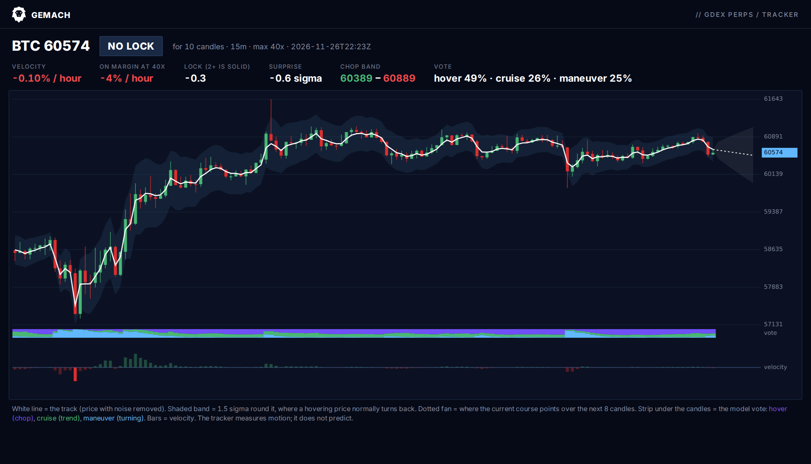</p>

### Scope: everything on one market

```bash
node scope.js xyz:SP500        # all read-outs plus three PNGs in out/
node scope.js BTC --no-png     # text only, no browser needed
```

## Placing and managing trades

Always look before you fire. `plan` sends nothing:

```bash
node degen.js plan --coin BTC --side long --sl 20 --tp 60 --lev half
```

<p align="center">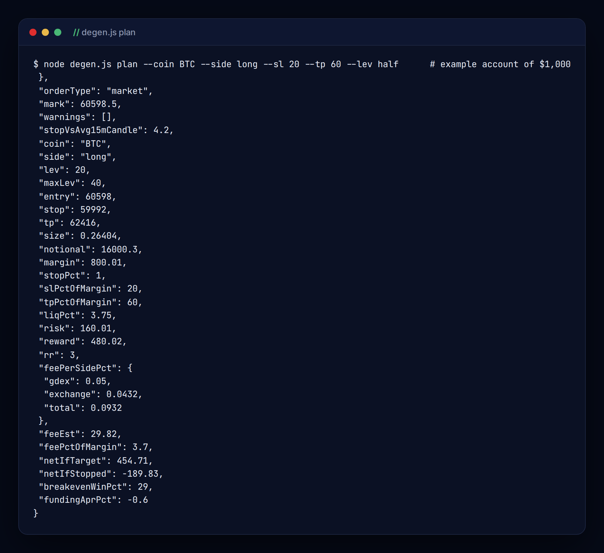</p>

Then the same line with `fire` places it, with the stop and target attached:

```bash
node degen.js fire  --coin BTC --side long --stop 59990 --tp-px 62400 --lev half     # stop and target as prices
node degen.js fire  --coin BTC --side long --sl 20 --tp 60 --lev max                 # or as percent of margin
node degen.js fire  ... --limit 59300                                                # resting limit entry
node degen.js fire  ... --margin 40                                                  # put up $40 instead of the default
node degen.js sl    --coin BTC --be            # stop to breakeven     (--lock 30, --pct 10, --to PRICE)
node degen.js tp    --coin BTC --pct 150       # move the target       (--to PRICE, --off)
node degen.js flat  --coin BTC                 # close
node pos.js                                    # what am I up
```

| Built in | Default |
|---|---|
| Every entry carries a stop and a target | always |
| A stop further than 70% of the way to liquidation is refused | always |
| Size when you give no size | **80% of the account** (`DEGEN_DEFAULT_MARGIN_PCT`) |
| Cap on dollars risked per trade | off (`DEGEN_MAX_RISK_USD`) |
| Cap on total open risk, % of account | off (`DEGEN_MAX_RISK_PCT`) |
| Drawdown brake | off (`DEGEN_DD_FLOOR`) |

Everything about orders, sizing, stops and what each number in `plan` means: [docs/TRADING.md](docs/TRADING.md).

## Fees

Per side, as a share of position size:

| Market | GDEX | HyperLiquid | Total |
|---|---|---|---|
| Main markets (BTC, ETH, SOL...) | 0.05% | 0.0432% | 0.0932% |
| Builder-venue markets (`xyz:NVDA`...) | 0.05% | 0.0086% (measured on `xyz:NVDA`) | 0.0586% |

GDEX's fee is 0.05% on every perp market. Leverage does not change the fee; it makes the same fee a bigger share of the margin you
put up. `plan` shows the fee in dollars before every trade. Other costs: HyperLiquid keeps $1 on a withdrawal, and a deposit needs
a 1% buffer.

## Safety

- **Your key stays on your machine**, in `~/.degen/wallet.json`, mode 600, outside the repo. The tools never print it.
- **How custody works:** the key signs you in to GDEX. GDEX holds the trading wallet (the deposit address) and places orders on
  HyperLiquid for you. You are trusting GDEX with the money in that wallet, as you would on gdex.pro.
- **The read-only tools use no key.** They read public market data and your public address.
- **Keep trading money small** until you have run the whole loop once: deposit, one tiny trade, close, withdraw.
- Report a security problem privately: see [SECURITY.md](SECURITY.md).

## More docs

| | |
|---|---|
| [docs/INSTALL.md](docs/INSTALL.md) | Step-by-step install, funding, withdrawing, updating, removing |
| [docs/CLAUDE-CODE.md](docs/CLAUDE-CODE.md) | Driving it by talking: phrases, status line, permissions |
| [docs/TOOLS.md](docs/TOOLS.md) | Every tool, every flag, how to read the output |
| [docs/TRADING.md](docs/TRADING.md) | Orders, sizing, stops, margin modes, fees, the journal |
| [docs/TROUBLESHOOTING.md](docs/TROUBLESHOOTING.md) | Error messages and what to do |
| [research/FINDINGS.md](research/FINDINGS.md) | What the research says, what was built from it, replay results |

## Licence

MIT. See [LICENSE](LICENSE). Built by [Gemach](https://gemach.io) on [GDEX](https://gdex.pro).
