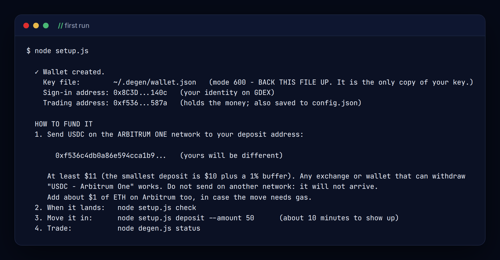
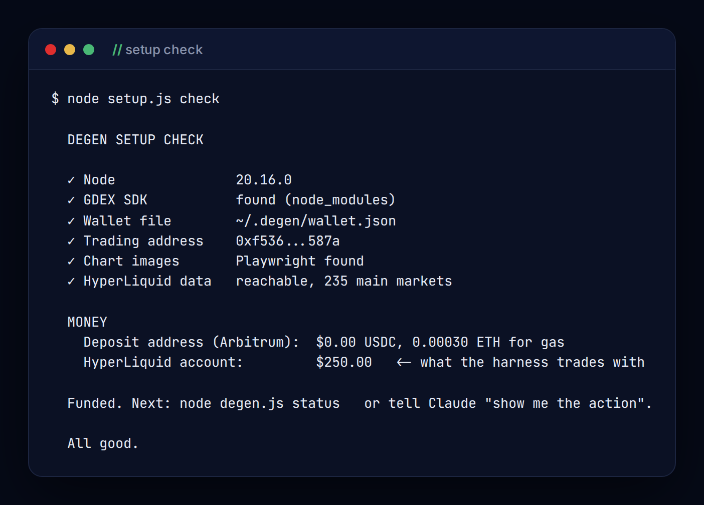

# Install, fund, withdraw

Tested on Linux with Node 20. macOS works the same way. On Windows, use [WSL](https://learn.microsoft.com/windows/wsl/install)
and follow the Linux steps inside it.

## 1. What you need

| | |
|---|---|
| Node.js 20 or newer | `node -v` to check. Get it from [nodejs.org](https://nodejs.org). `npm install` may warn that the GDEX SDK prefers Node 22; it works on 20. |
| git | `git --version` |
| Claude Code (to drive it by talking) | [claude.com/claude-code](https://claude.com/claude-code) |
| USDC you can send on Arbitrum One | From an exchange or your own wallet. $11 is the smallest amount that works. |

## 2. Install

```bash
git clone https://github.com/GemachDAO/degen-harness.git
cd degen-harness
npm install
```

The read-only tools work straight away, with no wallet and no money:

```bash
node sectors.js
node scan.js
node levels.js BTC
```

## 3. Create your wallet

```bash
node setup.js
```

<p align="center"></p>

What this does:

1. Makes a new wallet and saves it to `~/.degen/wallet.json`, readable only by you (mode 600). It is saved before anything else
   happens, so the key cannot be lost halfway.
2. Signs you in to GDEX with it. GDEX answers with your **trading address**: the wallet that holds your money and trades for you.
3. Writes that public address to `config.json` in this folder, so the read-only tools know which account to show.

Running `node setup.js` again never makes a second wallet. It just shows the deposit address and the steps again.

> [!IMPORTANT]
> **Back up `~/.degen/wallet.json` now.** Copy it to a password manager or an encrypted drive. If you lose it you lose access to
> the account. Never paste it into a chat, never commit it, never send it to anyone, including anyone claiming to be Gemach support.

**Already have a GDEX agent wallet file?** Point the harness at it instead: `export DEGEN_WALLET=/path/to/wallet.json`. It needs a
`control` block (`address`, `privateKey`) and `managed["Arbitrum (HyperLiquid)"].address`, the shape `setup.js` writes.

## 4. Fund it

Your money goes in two hops: **you → deposit address on Arbitrum → HyperLiquid account**.

### Hop 1: send USDC on Arbitrum One

Send USDC to the deposit address `setup.js` printed (it is also the "Trading address" in `node setup.js check`).

- Token: **USDC** (native USDC, contract `0xaf88d065e77c8cC2239327C5EDb3A432268e5831`)
- Network: **Arbitrum One**
- Amount: **at least $11**. The smallest deposit into the exchange is $10 and the deposit address must hold the amount plus 1%.
- Also send about **$1 of ETH on Arbitrum** to the same address, in case the deposit needs gas.

From an exchange: withdraw USDC, paste the address, and pick **Arbitrum One** as the network. From a wallet: switch to the Arbitrum
network and send USDC.

Check that it landed:

```bash
node setup.js check
```

### Hop 2: move it into HyperLiquid

```bash
node setup.js deposit --amount 50 --dry    # see what would happen
node setup.js deposit --amount 50          # do it
```

It takes about 10 minutes to show up. Run `node setup.js check` until "HyperLiquid account" shows the money.

<p align="center"></p>

> [!CAUTION]
> If a deposit, withdrawal or send reports an error, **do not run it again straight away.** A money move can go through even when
> the answer was an error. Wait a few minutes, run `node setup.js check`, and compare the balances first.

## 5. First trade: keep it tiny

Run the whole loop once with a small amount before you trust it with more:

```bash
node degen.js plan --coin BTC --side long --sl 20 --tp 60 --margin 12 --lev 5    # look at the numbers
node degen.js fire --coin BTC --side long --sl 20 --tp 60 --margin 12 --lev 5    # LIVE: $12 of margin
node pos.js                                                                      # see it
node degen.js flat --coin BTC                                                    # close it
```

A position must be worth at least $11, which is margin times leverage.

## 6. Connect Claude Code

```bash
claude                      # inside this folder: the skill loads by itself
node setup.js claude        # or install the skill so it works from any folder
```

See [CLAUDE-CODE.md](CLAUDE-CODE.md).

## 7. Chart images (optional)

```bash
npm run charts
```

This installs Playwright and its Chromium browser (about 150 MB). After that `scope.js` and `shot.js` write PNG charts to `out/`.
Without it everything still works as text: `node scope.js BTC --no-png`. On a bare Linux server Chromium may need system
libraries: `npx playwright install-deps chromium`.

## Taking money out

```bash
node setup.js withdraw --amount 50                     # HyperLiquid -> your deposit address on Arbitrum. HyperLiquid keeps $1.
node setup.js check                                    # wait for it to land (a few minutes)
node setup.js send --to 0xYourOwnAddress --amount 49   # deposit address -> any Arbitrum address
```

`send` cannot be undone. Read the address twice. Close your positions first: money held as margin cannot be withdrawn.

## Updating

```bash
git pull
npm install
node setup.js claude     # only if you installed the skill for every folder
```

Your wallet, `config.json` and journal are not touched by an update.

## Removing it

Withdraw your money first. Then delete the folder, `~/.degen/` and `~/.claude/skills/degen/`. Keep a backup of the wallet file
until you are sure the account is empty.

## Files it writes

| File | What | Secret? |
|---|---|---|
| `~/.degen/wallet.json` | Your key | **Yes** |
| `.session.json` | The current GDEX sign-in (expires within 8 hours) | **Yes** |
| `config.json` | Your public trading address | No |
| `journal.jsonl` | Every live action, with the plan and the exchange's answer | No (it is your trade history) |
| `.equity.json` | Highest account value seen, for the drawdown brake | No |
| `out/` | Charts | No |

All of them are git-ignored.

## Settings

Set these as environment variables.

| Variable | What | Default |
|---|---|---|
| `DEGEN_WALLET` | Path to the wallet file | `~/.degen/wallet.json` |
| `DEGEN_ADDRESS` | Public address for the read-only tools | from `config.json` |
| `DEGEN_DEFAULT_MARGIN_PCT` | Share of the account used when a trade names no size | `80` |
| `DEGEN_MAX_RISK_USD` | Refuse a trade that risks more dollars than this | off |
| `DEGEN_MAX_RISK_PCT` | Refuse when open plus resting risk passes this % of the account | off |
| `DEGEN_DD_FLOOR` | Drawdown brake: percent sizes shrink as the account falls from its peak and stop at this % | off |
| `DEGEN_ARB_RPC` | Arbitrum RPC used to read the deposit address balance | `https://arb1.arbitrum.io/rpc` |
| `DEGEN_PLAYWRIGHT` | Path to an existing Playwright install | this folder's |
| `GDEX_SKILL_DIR` | Use a local build of the GDEX SDK instead of the npm package | off |
| `GDEX_API_KEY` | A GDEX API key of your own | the SDK's shared key |
| `NO_COLOR` | Turn terminal colours off | off |
| `DEGEN_DEBUG` | Show full error traces | off |
