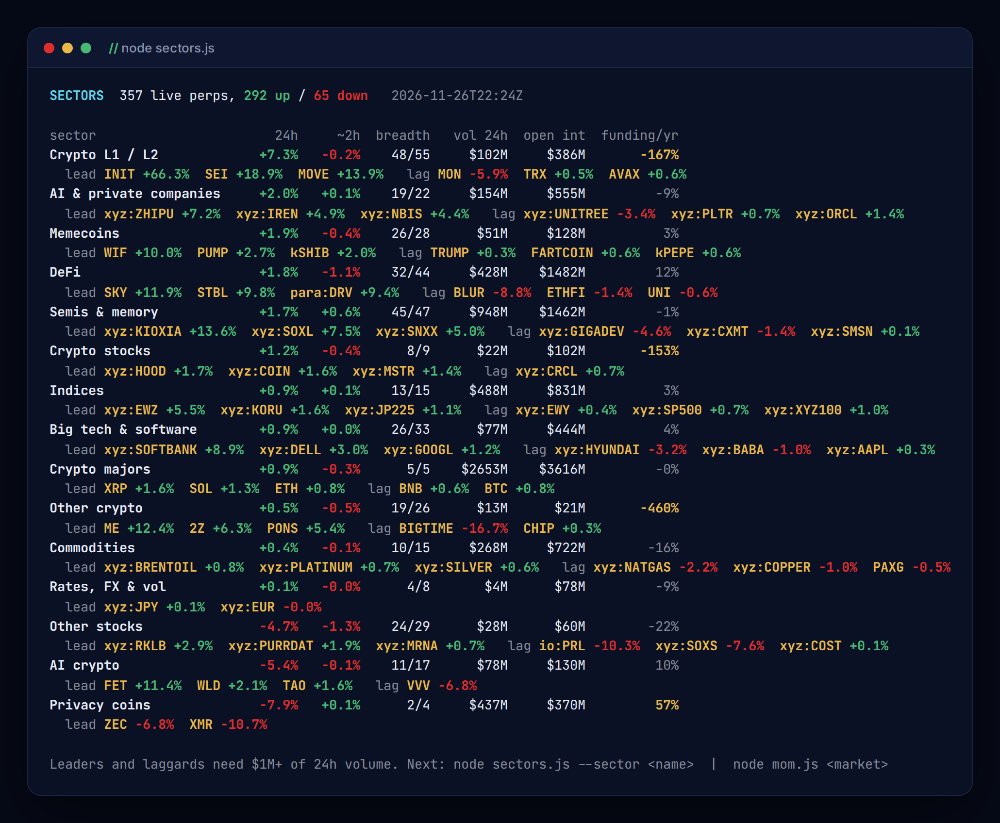
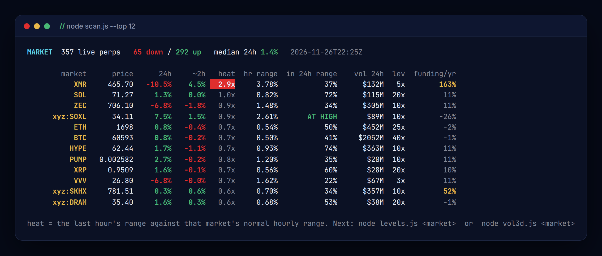
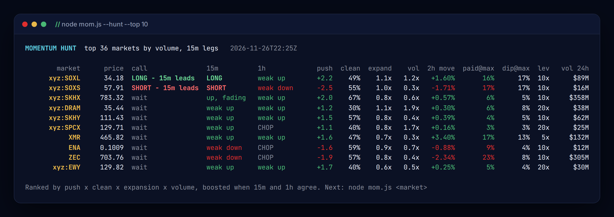
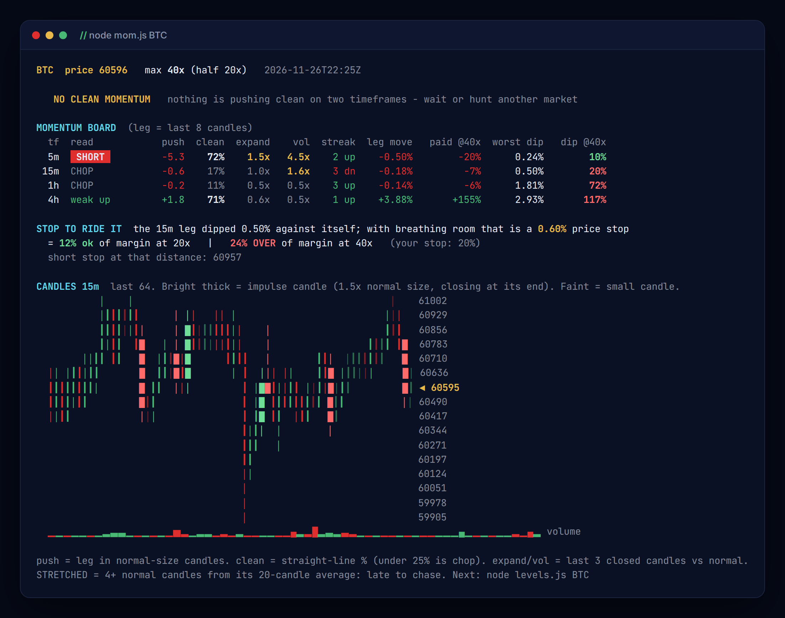
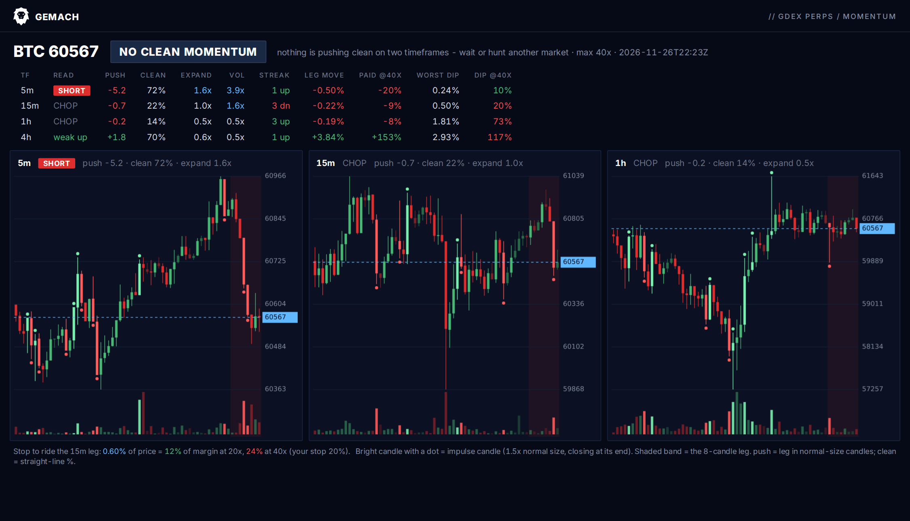
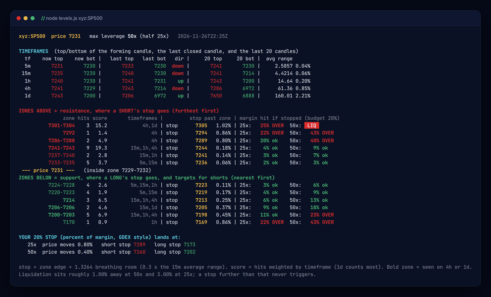
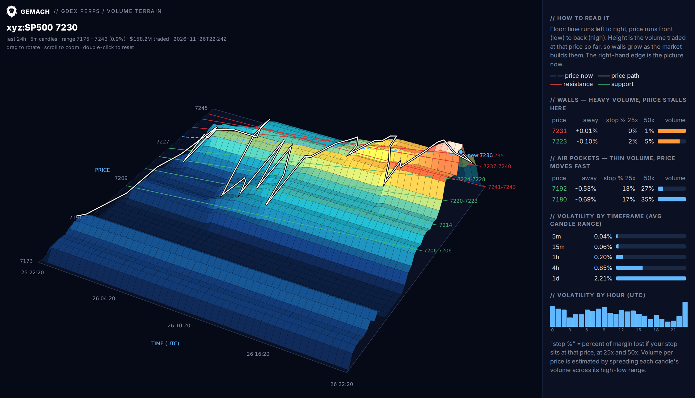
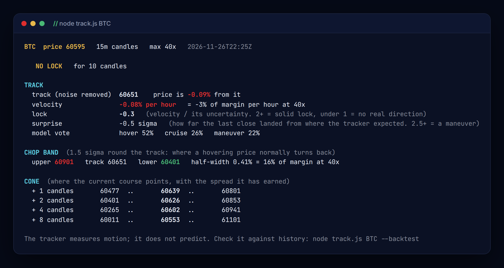
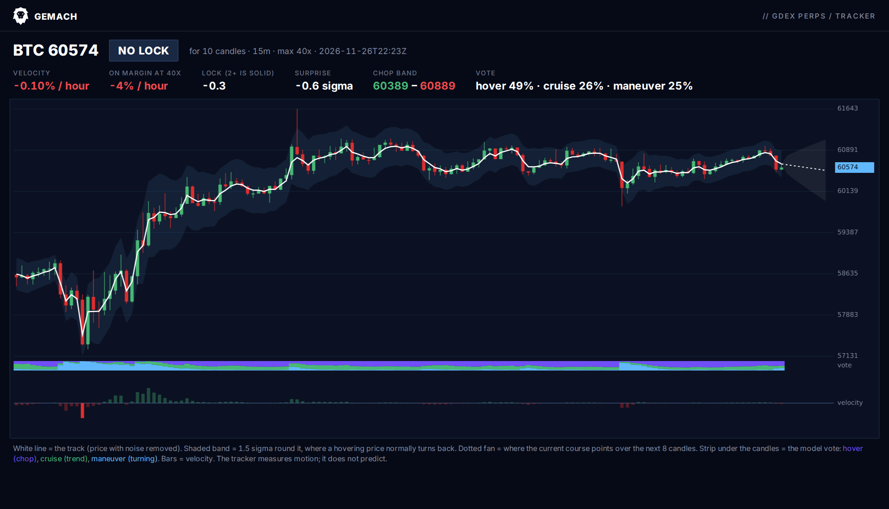

# Tools

All of these are read-only and need no key. They read HyperLiquid's public market data. Markets are named like the exchange names
them: `BTC`, `ETH`, `SOL` on the main venue, and `venue:TICKER` on builder venues (`xyz:NVDA`, `xyz:SP500`, `xyz:SILVER`).
`node sectors.js` lists what exists.

Common flags: `--no-color`, and `--json` where noted.

## sectors.js: the whole board

```bash
node sectors.js                  # sector table, leaders and laggards
node sectors.js --sector semis   # every market in one sector
node sectors.js --json
```

<p align="center"></p>

| Column | Meaning |
|---|---|
| 24h | Volume-weighted change of the sector |
| ~2h | The same for its three biggest markets over the last two hourly candles |
| breadth | Markets up / total. Wide breadth is a theme; one name alone is a story |
| open int | Open interest in dollars |
| funding/yr | What longs pay shorts per year at the current rate (negative: shorts pay longs) |

## scan.js: what is moving hardest

```bash
node scan.js [--top 15] [--json]
```

<p align="center"></p>

`heat` = the last hour's range as a multiple of that market's normal hourly range. `in 24h range` = where price sits between the
24-hour low (0%) and high (100%).

## mom.js: momentum

```bash
node mom.js BTC                 # board for 5m / 15m / 1h / 4h and a candle chart in the terminal
node mom.js xyz:NVDA --tf 5m    # chart another timeframe (default 15m)
node mom.js BTC --png           # also write out/BTC-mom.html (shot.js makes the PNG)
node mom.js --hunt [--top 12]   # rank the most traded markets, long and short
```

<p align="center"></p>
<p align="center"></p>
<p align="center"></p>

The leg is the last 8 candles. For each timeframe:

| Column | Meaning |
|---|---|
| push | Net move of the leg, counted in normal-size candles. + up, - down |
| clean | Net move / total distance travelled. 100% is a straight line, 0% is chop |
| expand | Range of the last 3 candles against the 20 before the leg |
| vol | Volume of the last 3 candles against the same 20 |
| dip | The worst move against the leg while it ran: the stop you needed to stay in |
| paid | What the leg paid on margin at max leverage |

## levels.js: zones and stop cost

```bash
node levels.js BTC
node levels.js xyz:NVDA --budget 20   # budget = the most margin, in %, you accept losing at the stop
node levels.js ETH --json
```

<p align="center"></p>

Zones are clusters of candle tops and bottoms across 5m to 1d. `score` weighs the hits by timeframe (daily counts most) and by how
recent they are. For each zone: the stop just past it, how far that is in percent of price, and what it costs in percent of margin
at half and max leverage. `OVER` = more than your budget. `LIQ` = the position is liquidated before the stop triggers.

## vol3d.js: 3-D volume terrain

```bash
node vol3d.js BTC                 # last 24h from 5m candles -> out/BTC-3d.html (interactive)
node vol3d.js xyz:NVDA --hours 48
node shot.js out/BTC-3d.html      # -> out/BTC-3d.png
```

<p align="center"></p>

Floor = time (left to right) by price (front to back). Height = volume traded at that price in that half hour. Ridges are walls.
Valleys are air pockets. The side panel lists the walls and air pockets with their distance from price.

## track.js: chop, trend or turning

```bash
node track.js BTC                    # read-out and a cone for the next candles
node track.js BTC --tf 5m --png      # also write out/BTC-track.html
node track.js BTC --backtest         # replay its rules on history, after fees
node track.js --backtest-all
```

<p align="center"></p>
<p align="center"></p>

Three motion models run at once and the data votes: **hover** (chop), **cruise** (trend), **maneuver** (turn, breakout, news).
`lock` is how sure the filter is. `surprise` is how far the last candle landed from where it expected, in sigmas. It measures the
current motion; it does not predict the next.

## scope.js: everything on one market

```bash
node scope.js xyz:SP500        # momentum, levels and tracker read-outs, plus three PNGs and the interactive 3-D file in out/
node scope.js BTC --no-png     # text only
```

## pos.js: positions

```bash
node pos.js                 # positions, P&L, stops and targets, account
node pos.js --watch 10      # refresh every 10 seconds
node pos.js --json
```

## stats.js: your scorecard

```bash
node stats.js               # last 30 days
node stats.js --days 7
```

A trade is one round trip in a market, flat to flat, built from your HyperLiquid fills. Result = closed P&L minus fees. It shows
your win rate next to the break-even win rate at your own average win and loss.

## replay.js: do level setups work?

```bash
node replay.js                    # a basket of markets, 15m candles
node replay.js BTC xyz:NVDA --rr 3
```

Replays two setups (fade a zone, break out of a zone) on history, with and without the tracker as a filter, after fees. Results so
far are in [`research/FINDINGS.md`](../research/FINDINGS.md): nothing statistically solid.

## shot.js: chart file to PNG

```bash
node shot.js out/BTC-3d.html out/BTC-mom.html
```

Needs `npm run charts` once.

## statusline.js

A one-line account summary for the Claude Code status line. See [CLAUDE-CODE.md](CLAUDE-CODE.md).

## Rate limits

HyperLiquid's public API answers nothing when it gets a burst of requests. The tools retry for a few seconds. If one still gives
up it says so in one line; wait about 10 seconds and run it again.
