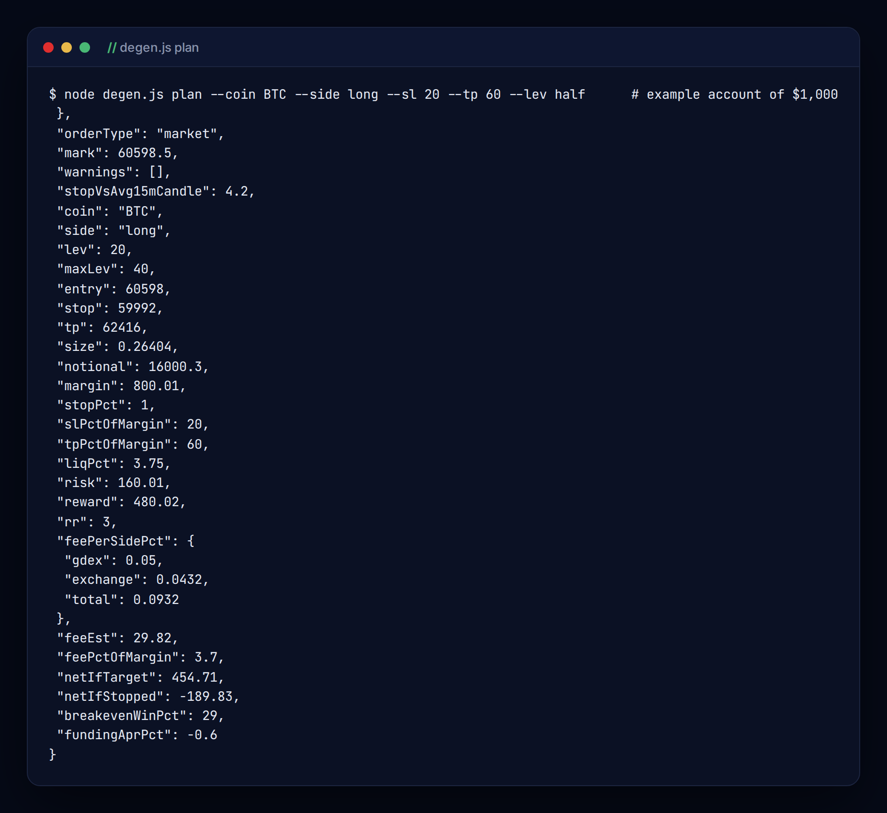

# Trading

`degen.js` is the order engine. `plan` and `status` send nothing. `fire`, `flat`, `cancel`, `entry`, `sl`, `tp` and `move` are
**live** and act on your real account.

## Look first: plan

```bash
node degen.js plan --coin BTC --side long --sl 20 --tp 60 --lev half
```

<p align="center"></p>

| Field | Meaning |
|---|---|
| `entry`, `stop`, `tp` | The prices that will be sent |
| `lev`, `maxLev` | Leverage used, and the market's maximum |
| `size`, `notional` | Position size in coins and in dollars |
| `margin` | Dollars of your account put up |
| `stopPct` | How far the stop is from entry, in percent of price |
| `slPctOfMargin`, `tpPctOfMargin` | Stop and target as percent of margin, the way gdex.pro shows them |
| `liqPct` | Roughly how far liquidation is, in percent of price |
| `risk`, `reward`, `rr` | Dollars lost at the stop, won at the target, and the ratio |
| `feePerSidePct` | The fee split: GDEX, the exchange, total |
| `feeEst`, `feePctOfMargin` | Round-trip fee in dollars, and as a share of margin |
| `netIfTarget`, `netIfStopped` | Result after fees either way |
| `breakevenWinPct` | The share of trades like this that must hit the target just to break even |
| `stopVsAvg15mCandle` | Stop distance in average 15-minute candles. Under 1 means normal noise can take it out |
| `warnings` | Read every one |

## Stops and targets

Two ways to say them. Use either on any command.

| | Stop | Target |
|---|---|---|
| As a price | `--stop 59990` | `--tp-px 62400` |
| As percent of margin | `--sl 20` | `--tp 60` |

Percent of margin is price move times leverage: at 20x, a 1% move against you is 20% of margin.

**Put the stop where the trade is proven wrong, not at a round percent.** Run `node levels.js X`, pick the zone that would prove
you wrong, and place the stop just past it. `levels.js` shows what that costs at half and max leverage. If it costs more than you
want to lose, the answer is less leverage or a smaller size, not a tighter stop inside the noise.

`plan` refuses a stop further than 70% of the way to liquidation: you would be liquidated before the stop could work.

## Entering

```bash
node degen.js fire --coin BTC --side long --stop 59990 --tp-px 62400 --lev half     # market entry
node degen.js fire --coin BTC --side long --limit 59300 --sl 20 --tp 60 --lev half  # resting limit entry
```

- A market entry fills now. The stop and target are attached in the same order.
- A limit entry rests until price reaches it. It must be below the price for a long and above it for a short. The stop and target
  arm when it fills. Percent stops count from the limit price.
- `--lev` takes `max`, `half` or a number.

## Sizing

| Flag | Meaning |
|---|---|
| *(none)* | **80% of the account as margin.** Change with `DEGEN_DEFAULT_MARGIN_PCT`. |
| `--margin 40` | Put up $40 |
| `--margin-pct 20` | Put up 20% of the account as it stands now |
| `--risk 20` | Size the position so the stop loses $20 |
| `--risk-pct 4` | Size it so the stop loses 4% of the account |

> [!WARNING]
> The default is aggressive on purpose: it is the author's style. At 80% of the account, a stop that costs 20% of margin loses
> about 16% of the whole account, plus fees, on one trade. A few of those in a row is most of the account. If that is not what you
> want, set `export DEGEN_DEFAULT_MARGIN_PCT=10` (or any number) in your shell profile, or always name a size.

Optional rails, all off unless you set them:

| Variable | Effect |
|---|---|
| `DEGEN_MAX_RISK_USD=30` | Refuse any trade whose stop loses more than $30 |
| `DEGEN_MAX_RISK_PCT=25` | Refuse when open plus resting risk passes 25% of the account |
| `DEGEN_DD_FLOOR=30` | Percent sizes shrink as the account falls from its peak and reach zero 30% down. `node degen.js peak` shows it; `peak --reset` restarts the peak |

The smallest position the exchange takes is about $11 (margin times leverage).

## Managing a position

These run straight away. Add `--dry` to preview.

```bash
node degen.js sl    --coin BTC --be              # stop to breakeven (entry plus fees)
node degen.js sl    --coin BTC --lock 30         # stop that locks in +30% of margin
node degen.js sl    --coin BTC --pct 10          # stop = lose 10% of margin
node degen.js sl    --coin BTC --to 61200        # stop at a price
node degen.js tp    --coin BTC --pct 150         # target = +150% of margin
node degen.js tp    --coin BTC --to 63000        # target at a price
node degen.js tp    --coin BTC --off             # take the target off and let it run
node degen.js tp    --coin BTC --pct 80 --maker  # a resting limit target instead of a trigger
node degen.js move  --coin BTC --lock 30 --tp-pct 200    # stop and target in one go
node degen.js entry --coin BTC --to 60100        # move a resting limit entry
node degen.js cancel --coin BTC                  # cancel resting entries (never a position's stop)
node degen.js flat  --coin BTC                   # close at market
node degen.js flat                               # close everything
node degen.js orders                             # everything resting, with order ids
node degen.js status                             # account, positions, open risk
```

Removing a stop is refused.

## Margin modes

You do not choose this; GDEX's back-end does.

| Market | Mode | What it means |
|---|---|---|
| Main markets (BTC, ETH, SOL...) | Cross | The whole account backs the position |
| Any `venue:` market (`xyz:NVDA`, `xyz:SP500`...) | Isolated | Only that position's margin is at stake, and it has its own liquidation price |

Stock-linked markets trade around the clock but are thin when US markets are closed. Expect wider spreads and sharper wicks then.

## Fees

Per side, as a share of position size:

| Market | GDEX | HyperLiquid | Total |
|---|---|---|---|
| Main markets | 0.05% | 0.0432% | 0.0932% |
| Builder-venue markets | 0.05% | 0.0086% (measured on `xyz:NVDA`) | 0.0586% |

On a $1,000 position in BTC that is about $0.93 to open and $0.93 to close. Leverage does not change the fee, but the same fee is
a bigger share of a smaller margin: at 20x, a round trip on a main market is about 3.7% of the margin you put up. When the stop is
so tight that fees pass a quarter of the risk, `plan` warns you. Positions held over time also pay or receive funding; `plan`
shows the current yearly rate.

## The journal and the scorecard

Every live action is appended to `journal.jsonl` with the plan and the exchange's answer. `node stats.js` builds your closed
trades from your real fills and sets your win rate against the break-even line. That scorecard, over many trades, is the only
honest test of whether what you are doing works.

## If something looks wrong

- A command that answers `ok: false` tells you what is still live. Read it, then run `node pos.js`.
- If the answer says the order was sent but the account could not be read back, the order may be live. Check `node pos.js` or
  gdex.pro before sending anything again.
- The account is a normal GDEX account. If you import the wallet into a browser wallet you can sign in at [gdex.pro](https://gdex.pro) and see or close the position there. Signing in there signs the harness out; it signs back in on its next command.
